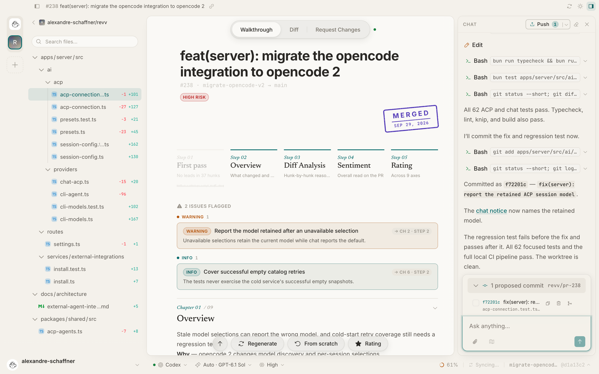
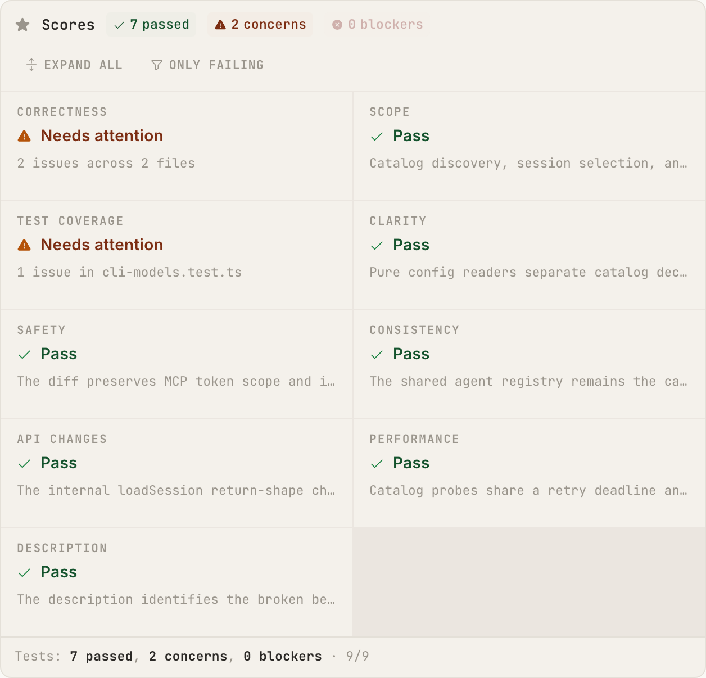
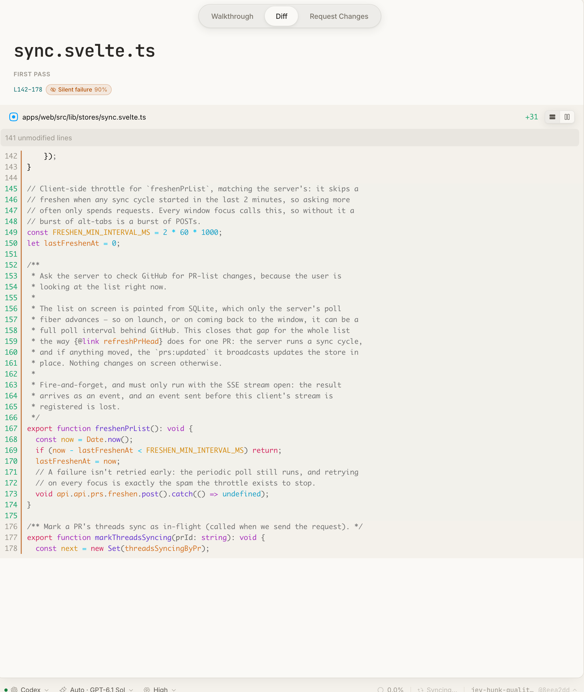
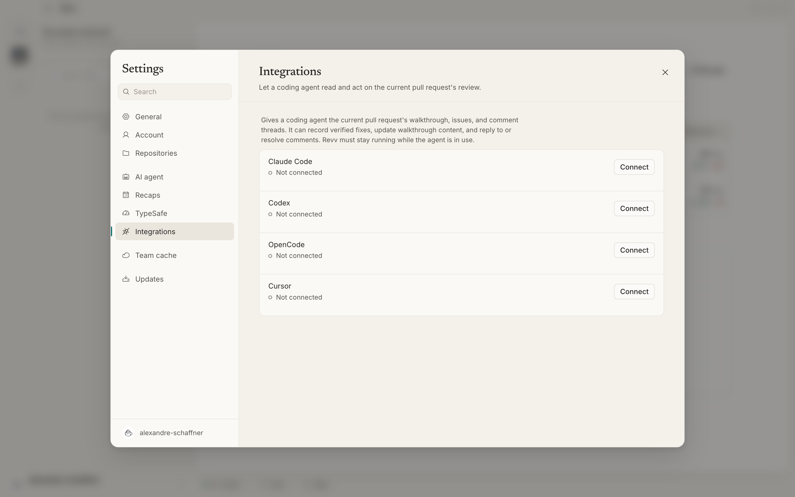
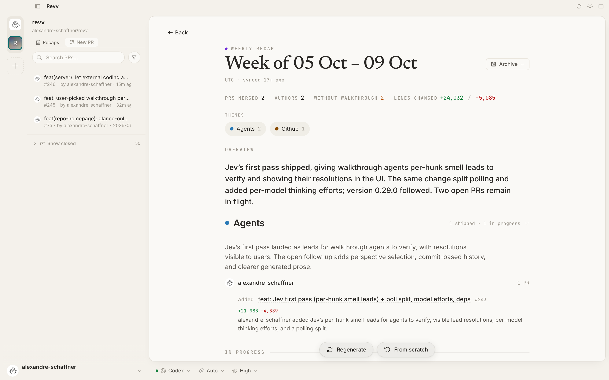

<p align="center">
  
</p>

<h1 align="center">Revv</h1>

<p align="center">
  <strong>Know what you're merging.</strong><br />
  AI code review for your desktop. Understand the change, challenge the agent, ship the fix.
</p>

<p align="center">
  <a href="https://github.com/alexandre-schaffner/revv/actions/workflows/ci.yml"></a>
  <a href="https://github.com/alexandre-schaffner/revv/releases"></a>
  <a href="LICENSE"></a>
</p>

<p align="center">
  <a href="#install"><strong>Install Revv</strong></a> ·
  <a href="#the-review-workflow">Explore the features</a> ·
  <a href="#build-from-source">Build from source</a> ·
  <a href="https://github.com/alexandre-schaffner/revv/issues">Report a bug</a>
</p>



<p align="center"><sub>A real review of Revv itself. The agent found an issue, wrote a fix, added a regression test, and proposed a commit.</sub></p>

Revv brings your GitHub pull requests, AI walkthroughs, diffs, and review conversations into one desktop app. Start with the reasoning behind a change, inspect the code, then ask your agent to explain it or fix it. Review the proposed commits and push them back to GitHub when you're ready.

**Bring your agent:** Claude Code, Codex, OpenCode, or Cursor. Choose the agent, model, and supported thinking effort in the app.

## Install

Available for **macOS**, currently in **alpha**.

```bash
curl -fsSL https://github.com/alexandre-schaffner/revv/releases/latest/download/install.sh | bash
```

The installer sets up the desktop app and `revv` CLI. Revv starts its local server when the app opens. Closing the window keeps both running in the tray; quitting Revv stops the server. The release installer verifies its Sigstore attestation before continuing.

<details>
<summary>Download and inspect the installer first</summary>

```bash
curl -fsSL https://github.com/alexandre-schaffner/revv/releases/latest/download/install.sh -o install.sh
less install.sh
gh attestation verify install.sh --repo alexandre-schaffner/revv
bash install.sh
```

</details>

1. **Connect GitHub.** Sign in with the device code shown by Revv.
2. **Pick your repositories.** Your pull requests start syncing into the app.
3. **Set up your agent.** Onboarding walks you through provider installation and sign-in.
4. **Open a PR.** Press <kbd>⌘</kbd> + <kbd>P</kbd>, find the change, and start reviewing.

## The review workflow

### Understand the whole change

Every walkthrough gives you a plain-language **overview**, a **risk assessment**, a guided **diff analysis**, an **overall verdict**, and judgments across **nine review axes**. Flagged issues link back to the relevant walkthrough steps so you can follow the evidence.

Walkthroughs track the PR's commit: new commits get a new review, and interrupted generation can resume from saved progress.

<details>
<summary>See the nine-axis review</summary>



</details>

### Turn feedback into a fix

The chat agent works inside the PR's own git worktree. Ask about the code, explore a plan, or request a fix with tests. Tool calls and responses stream into the panel as it works.

Changes arrive as **proposed commits**. Inspect them, cherry-pick the ones you want, discard others, and push from Revv. The agent can also help resolve merge conflicts.

> “Fix the warning. Add a regression test, run it, and commit.”

### Get down to the lines

Switch between **unified and split diffs**, navigate the file tree, and review syntax-highlighted changes with virtualized scrolling for large PRs. Persisted hunk decisions keep your place; inline threads and code suggestions keep the discussion beside the code.

Review comments sync with GitHub in both directions. Your work stays attached to the pull request.

<details>
<summary>See the diff view and first-pass leads</summary>



</details>

### Bring the review to your coding agent

Connect **Claude Code, Codex, OpenCode, or Cursor** from **Settings → Integrations**. Through MCP, your external agent can read the current PR's walkthrough, issues, and comment threads, record verified fixes, and respond to review conversations.

After pushing a fix, it can request a fresh walkthrough and wait for the results. One agent fixes the code; Revv reviews the next commit.

<details>
<summary>See the coding-agent integrations</summary>



</details>

### Catch up on what shipped

**Daily and weekly recaps** turn repository activity into a readable account of what changed, who contributed, and what's still in flight. Browse the archive when you need to catch up on an earlier period.



### Built for the daily review queue

| Feature | What you get |
| --- | --- |
| GitHub sync | Automatically refreshed PRs across your selected repositories. |
| Multiple accounts | Personal, work, and GitHub Enterprise accounts in one app. |
| Fast navigation | Fuzzy PR search with <kbd>⌘</kbd> + <kbd>P</kbd>; commands with <kbd>⌘</kbd> + <kbd>⇧</kbd> + <kbd>P</kbd>. |
| Your reading setup | Light, dark, or system appearance, plus an independent diff theme. |
| Local persistence | Review sessions, conversations, and generation progress saved in SQLite on your machine. |
| Team cache | Reuse teammates' generated walkthroughs through a configured shared cache. |

The app and its database run locally. GitHub sync talks to your GitHub host, and AI requests use your configured agent and provider.

## Build from source

You'll need **macOS**, **Bun 1.3+**, **Rust**, and the **Xcode Command Line Tools**. The development installer can help set up the toolchain:

```bash
git clone https://github.com/alexandre-schaffner/revv.git
cd revv
./install.sh --dev
make dev
```

Already have the toolchain? Run `bun install` followed by `make dev`. No `.env` setup is required for the default flow: the GitHub OAuth app is bundled, and the local auth secret is generated on first launch.

`make dev` uses a separate development database and API port (`45679`), alongside the frontend at `5173`, so it can run beside an installed Revv instance.

<details>
<summary>Architecture and contributor commands</summary>

| Layer | Stack | Location |
| --- | --- | --- |
| Desktop | Tauri v2 / Rust | [`apps/desktop`](apps/desktop) |
| Interface | SvelteKit / Svelte 5 / Tailwind CSS v4 | [`apps/web`](apps/web) |
| Local API | Bun / Elysia / Effect | [`apps/server`](apps/server) |
| Persistence | SQLite / Drizzle | [`apps/server/src/db`](apps/server/src/db) |
| Shared contracts | TypeScript / SSE event schemas | [`packages/shared`](packages/shared) |

```bash
make dev-server       # API only, using the isolated dev environment
make build            # build workspace packages
make dist             # build the macOS app bundle

# Full local CI, required before submitting code changes
bun run typecheck && bun run lint && bun run knip && bun run build
```

Read the [agent and contributor guide](AGENTS.md), [code conventions](docs/conventions.md), and [product roadmap](docs/prds/README.md) before making changes. Open pull requests against `main`.

</details>

## Manage your install

```bash
revv status      # versions, install paths, and server state
revv update      # update to the latest release
revv start       # start Revv in the tray with its server
revv stop        # quit Revv and stop its server
revv restart     # restart Revv and its server
revv logs        # tail server logs
revv open        # launch the app
revv uninstall   # remove the install
```

<details>
<summary>Troubleshooting sign-in</summary>

**“Failed to start sign-in: Load failed”** usually means the app cannot reach its local server:

```bash
revv status
revv restart
revv logs
```

**Using a custom GitHub OAuth app?** Enable **Device Flow** in that app's GitHub settings. The default bundled app already handles this setup.

For other problems, [open an issue](https://github.com/alexandre-schaffner/revv/issues) with your Revv version and relevant logs.

</details>

---

<p align="center">
  Built for people who read the diff.<br />
  <a href="LICENSE">MIT licensed</a> · <a href="https://github.com/alexandre-schaffner/revv/releases">Releases</a> · <a href="https://github.com/alexandre-schaffner/revv/issues">Issues</a>
</p>
